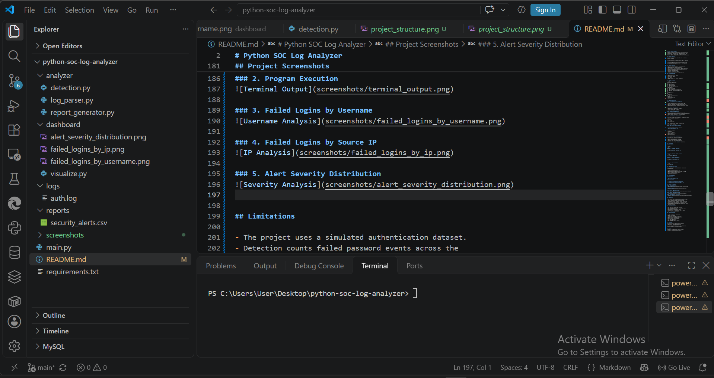
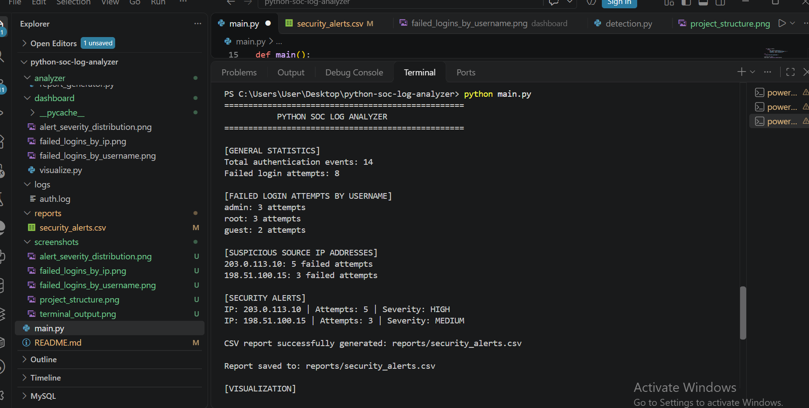
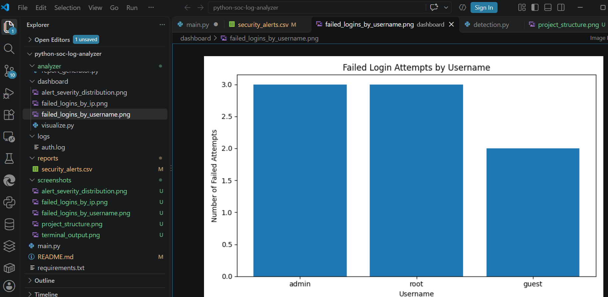
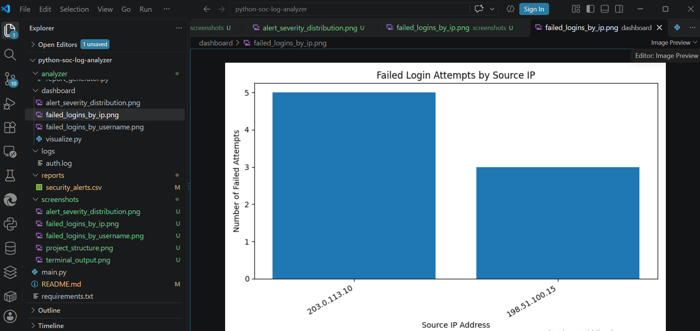
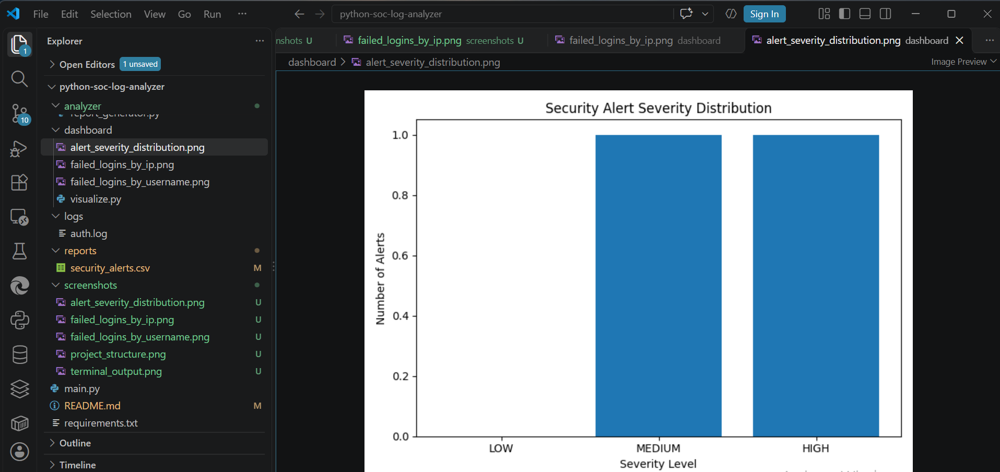

# Python SOC Log Analyzer

A Python-based Security Operations Center (SOC) project
that analyzes simulated Linux SSH authentication logs,
detects repeated failed login attempts, classifies
security alerts, and generates reports and visualizations.

## Project Overview

This project simulates a basic SOC Level 1 (L1) log
analysis workflow.

It processes Linux SSH authentication logs to identify
repeated failed login attempts from source IP addresses.

The analyzer generates security alerts, exports them
to CSV, and creates visualizations to help understand
authentication activity.

## Project Objectives

- Practice Python programming for cybersecurity.
- Understand Linux authentication logs.
- Extract useful information using regular expressions.
- Detect repeated failed login attempts.
- Identify source IP addresses with repeated failures.
- Classify alerts by severity.
- Generate CSV security reports.
- Visualize security events using Matplotlib.

## Technologies Used

- Python 3
- Regular Expressions (Regex)
- Collections module
- CSV module
- Matplotlib
- Pandas (listed as a project dependency)

## Project Structure

```text
python-soc-log-analyzer/
│
├── analyzer/
│   ├── log_parser.py
│   ├── detection.py
│   └── report_generator.py
│
├── dashboard/
│   ├── visualize.py
│   ├── failed_logins_by_username.png
│   ├── failed_logins_by_ip.png
│   └── alert_severity_distribution.png
│
├── logs/
│   └── auth.log
│
├── reports/
│   └── security_alerts.csv
│
├── main.py
├── requirements.txt
└── README.md
```

## Implemented Features

### 1. Linux Authentication Log Parsing

- Reads simulated Linux SSH authentication logs.
- Extracts timestamps, hostnames and process IDs.
- Extracts usernames, source IP addresses and ports.
- Recognizes successful, failed and invalid-user events.

### 2. Failed Login Detection

- Detects failed SSH password attempts.
- Counts failed login attempts.
- Identifies targeted usernames.

### 3. Suspicious IP Detection

- Groups failed password attempts by source IP.
- Identifies IP addresses reaching a configurable threshold.
- Uses a default threshold of 3 failed attempts.

### 4. Alert Severity Classification

The project assigns severity based on failed login counts:

| Failed Attempts | Severity |
|---|---|
| 1–2 | LOW |
| 3–4 | MEDIUM |
| 5 or more | HIGH |

These are educational example thresholds, not
universal SOC standards.

### 5. CSV Security Report Generation

The analyzer exports security alerts to:

`reports/security_alerts.csv`

The report includes:

- Timestamp
- Source IP address
- Failed login attempts
- Alert severity
- Alert description

### 6. Security Event Visualization

The project uses Matplotlib to generate:

- Failed login attempts by username.
- Failed login attempts by source IP.
- Security alert severity distribution.

Charts are saved in the `dashboard/` directory.

## Installation

### Requirements

- Python 3
- pip

### Step 1: Clone the repository

```bash
git clone https://github.com/mulugetaberhe386/python-soc-log-analyzer.git
```

### Step 2: Enter the project directory

```bash
cd python-soc-log-analyzer
```

### Step 3: Install dependencies

```bash
pip install -r requirements.txt
```

### Step 4: Run the analyzer

```bash
python main.py
```

## Sample Analysis Results

Using the included simulated dataset, the analyzer
should identify:

- Total authentication events: 14
- Failed password attempts: 8
- Most frequent failed-login source: 203.0.113.10
- Failed attempts from that source: 5
- High severity alerts: 1
- Medium severity alerts: 1

## Generated Outputs

### CSV Report

`reports/security_alerts.csv`

### Visualizations

- `dashboard/failed_logins_by_username.png`
- `dashboard/failed_logins_by_ip.png`
- `dashboard/alert_severity_distribution.png`

## Project Screenshots

### 1. Project Structure


### 2. Program Execution


### 3. Failed Logins by Username


### 4. Failed Logins by Source IP


### 5. Alert Severity Distribution



## Incident Summary Report

The analyzer automatically generates a text-based security incident summary.

The report includes:
- Total authentication events
- Failed login attempts
- Suspicious source IP addresses
- Security alert severity
- Recommended defensive actions

**Generated report:**
`reports/incident_summary.txt`


## Authentication Activity Timeline

The project generates a timeline visualization of SSH authentication events.

The chart displays:
- Successful login events
- Failed login attempts
- Invalid username events

Events are plotted chronologically using their timestamps.

**Generated chart:** `dashboard/authentication_timeline.png`

## Limitations

- The project uses a simulated authentication dataset.
- Detection counts failed password events across the
  entire input file rather than a time window.
- Invalid-user events are parsed but are not included
  in the current failed-password IP detection count.
- Severity thresholds are simple educational rules.
- A repeated failed login does not automatically prove
  malicious activity.

## Future Improvements

- Add time-based failed-login detection.
- Include invalid-user events in detection rules.
- Add automated unit tests.
- Improve alert investigation details.
- Integrate with a SIEM platform such as Wazuh.
- Add an interactive dashboard.

## Learning Outcomes

Through this project, I practiced:

- Python programming.
- Regular expression pattern matching.
- Linux SSH authentication log analysis.
- Basic security event detection.
- Alert severity classification.
- CSV report generation.
- Data visualization.
- Git and GitHub version control.

## Disclaimer

This project is for educational and defensive
cybersecurity learning purposes only.

It uses simulated authentication logs and does not
perform attacks or access real systems.

## Author

Created as a cybersecurity learning project
focused on SOC Level 1 analyst skills.
